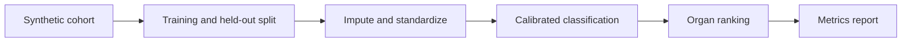

# Architecture and engineering decisions

> **Scope:** a local reference implementation using invented/synthetic inputs. No production deployment or service-level claims are implied.

## Synthetic research-only classification and ranking

**Actual processing path:** Seeded synthetic cohort --> Training split --> Imputation/scaling --> Calibrated classifier + organ classifiers --> Held-out AUROC/AUPRC/Brier/top-2 metrics.

## Key files

- `triagerank/benchmark.py`: synthetic cohort, calibration, organ ranking and metric functions.
- `triagerank/__main__.py`: reproducible report command.

## Failure modes / trust boundaries

NEVER use for clinical advice or patient prioritisation. The synthetic labels encode designed relationships; results do not transfer to real populations and do not represent MIMIC-IV validation.

## What I would build next

If legitimately authorised, research governance, cohort documentation, temporal splitting, external validation and fairness analysis.

## Reviewer checklist

1. Read the source and confirm the processing path above.
2. Follow `docs/DEMO.md` and run the tests locally.
3. Inspect CI and document any divergence between local and GitHub results.
4. Treat all benchmarks as synthetic demonstrations unless proven otherwise.
